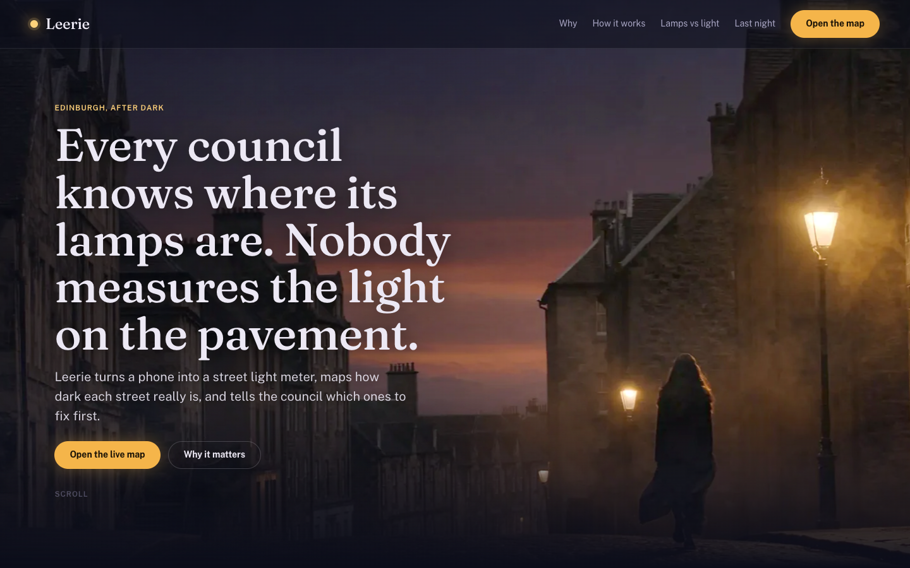
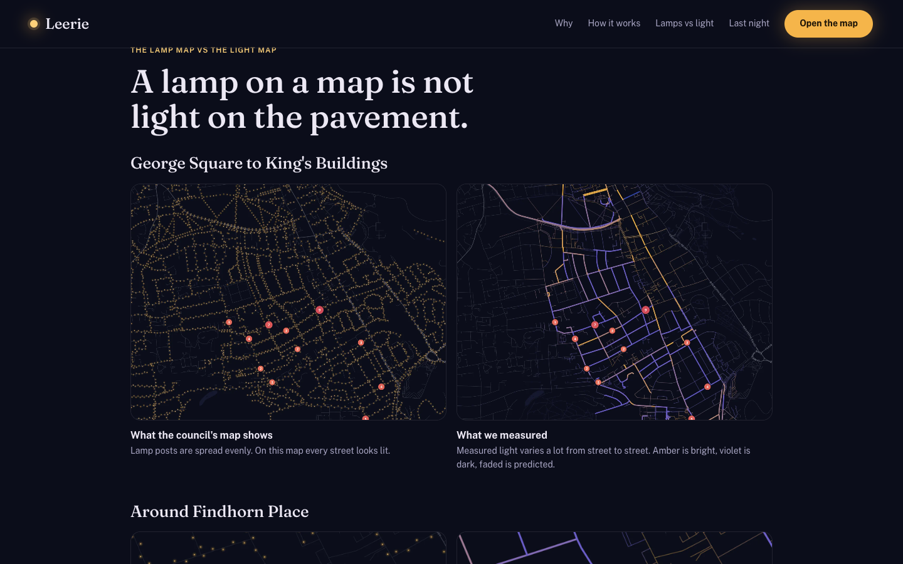
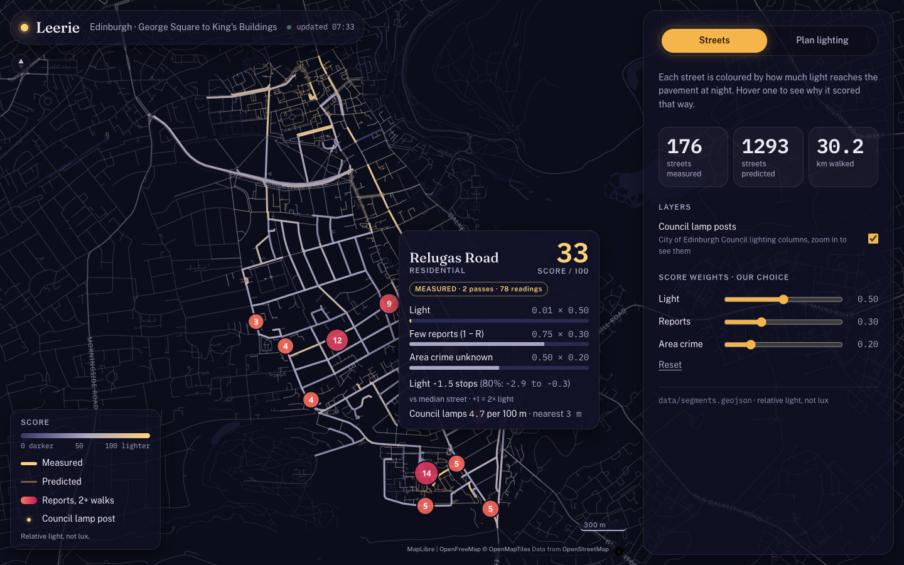
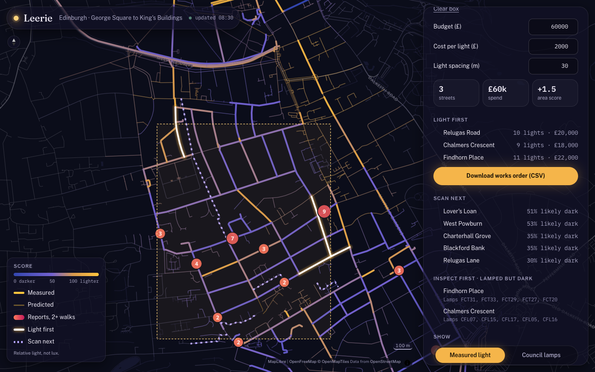
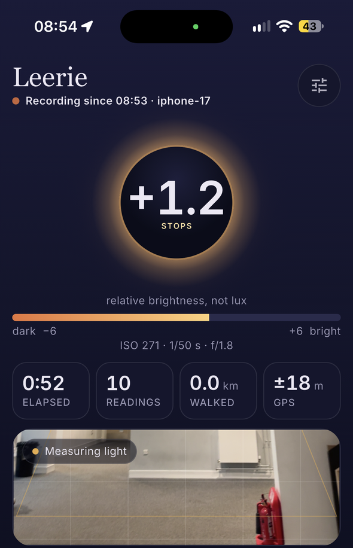
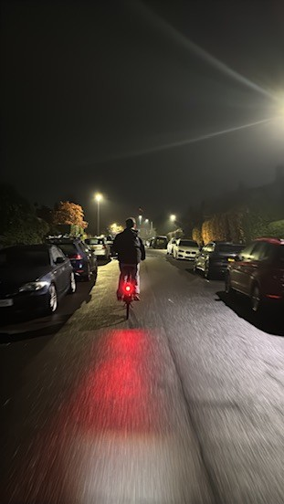

# Leerie

**Any phone becomes a street light meter.** Leerie maps how much light actually reaches Edinburgh's pavements at night, predicts the streets nobody measured, and tells the council which ones to fix first.

**Live:** [leerie.vercel.app](https://leerie.vercel.app) · **Map:** [leerie.vercel.app/map](https://leerie.vercel.app/map) · Built at HackTheBurgh XIII, 7–8 November 2026



## Why

One in two women in Britain feels unsafe walking alone after dark on a quiet street near home; for men it is one in seven ([ONS, 2021](https://www.ons.gov.uk/peoplepopulationandcommunity/crimeandjustice/bulletins/perceptionsofpersonalsafetyandexperiencesofharassmentgreatbritain/2to27june2021)). In Scotland, 35% of women don't feel safe walking alone in their own area after dark, against 10% of men ([Scottish Crime and Justice Survey 2019/20](https://www.gov.scot/publications/scottish-crime-justice-survey-2019-20-main-findings/pages/35/)).

Light is one of the few things a council can change: in a randomised trial in New York City, extra street lighting cut night-time outdoor crime by at least 36% ([Chalfin et al., NBER](https://econpapers.repec.org/RePEc:nbr:nberwo:25798)). But councils know where their lamps are, not how much light reaches the pavement. A dead lantern, a tree or a long gap between posts doesn't show up on a lamp map.

## What it does

**A lamp on a map is not light on the pavement.** On the left, the City of Edinburgh Council's lamp posts. On the right, the light we measured.



1. **Walk.** Open the app, point the camera ahead and go. Each frame becomes a light reading; one a second is uploaded with its GPS point. Comfortable / Uncomfortable buttons record how a street feels. No image ever leaves the phone.
2. **Map.** Readings are matched to OpenStreetMap streets and compared in *stops*. Streets nobody measured are predicted from their neighbours, drawn faded, with a range.
3. **Decide.** A council officer draws a box and enters a budget, a cost per light and a spacing. Leerie picks the streets that gain the most per pound, exports a works order, lists where one more walk would change the plan, and flags streets that have lamps but still measure dark.

| Every street's score shows its working | A budget becomes a works order |
| --- | --- |
|  |  |

| The phone app (iOS and Android) | Collecting data, 3am |
| --- | --- |
|  |  |

## One night of data

| | |
| --- | --- |
| Light readings matched to streets | 5,833 |
| Streets measured / predicted | 176 / 1,293 |
| Distance covered | 30.2 km, George Square to King's Buildings |
| Council lamp posts joined | 5,504 |
| **Lamped, but dark** (Inspect first) | Buccleuch Place (2.7 stops darker than its neighbours), Findhorn Place (2.3), Chalmers Crescent (2.3) |

The site reads these live from `data/`; this table is a snapshot.

## How it decides dark or bright

1. **The phone measures light.** Each frame's pixels are linearised and averaged, then the camera's auto-exposure is undone with its own metadata, the method the [phyphox](https://phyphox.org) lab app uses:
   `brightness = pixel brightness × aperture² ÷ (shutter time × ISO)`
   A dark street still reads dark even though the camera brightened the picture. iOS frames use video-range luma (16–235).
2. **Bad readings are dropped:** GPS worse than 15 m, moving faster than 5 m/s, after 06:30, or no exposure data.
3. **Each reading snaps to the nearest street** within 15 m. A street counts as measured with 3+ readings; its value is the median per walk, then the median across walks, so one passing headlight doesn't swing it.
4. **Compared in stops** with the local median, using up to seven measured neighbours within 75 m. A measured street also contributes its own value. Zero is typical locally, −1 is half the light, and +1 is double. Relative, not lux.
5. **Unmeasured streets** use the median of the closest two or three measurements from different segments, with the range widened by their spread plus one stop. A segment without enough local measurements has no score.
6. **Score** (0–100) is the percentile of the segment's light against its local measured reference. Reports are displayed separately.
7. **Decisions:**
   - *Light first:* places proposed posts along streets inside the selected area. Defaults are £200,000, £1,000 per post and roughly 30 m spacing. The plan skips sites within half the spacing of a known or proposed post and estimates gains for the stretches served, using the local upper quartile as the target.
   - *Scan next:* predicted streets whose chance of being dark (more than 1 stop below typical) is closest to 50/50, weighted by what lighting them would gain.
   - *Inspect first:* streets with at least as many council lamps per 100 m as a typical measured street, but 2+ stops darker than their measured neighbours.
8. **Reports** only count as confirmed once two different walks report the same street, so one person can't brand it.

## Data sources

- Our phones: `light_readings` and `incidents` in Supabase (PostGIS)
- Streets: [OpenStreetMap](https://www.openstreetmap.org) via Overpass
- Lamp posts: City of Edinburgh Council street lighting columns (British National Grid, converted with pyproj)
- Opening image generated with Higgsfield

## Privacy

- No images leave the phone: frames are reduced to one number and thrown away.
- No accounts: each walk gets a random ID.
- The app's key can only insert rows, never read them (row-level security).
- The map shows per-street summaries only, never anyone's path or individual reports.

## Limits

- Brightness is relative, not lux. One lux-meter reading would anchor it to the lighting classes councils design to (BS 5489-1).
- No per-phone calibration yet; every reading carries its device model so it can be added.
- Predictions are a neighbour average, not a trained model.
- The lamp data covers pole-mounted council lamps; wall-mounted lamps on tenement streets are missing.
- A brighter street is not a promise of safety, and Leerie does not predict crime.

## Repo

| Folder | What |
| --- | --- |
| `sensor/` | Flutter app for iOS and Android |
| `supabase/` | Tables and insert-only policies |
| `pipeline/` | `run.py` (Supabase → `data/segments.geojson`), `lamps.py` (council lamps → `data/lamps.geojson`) |
| `data/` | The files the site reads |
| `dashboard/` | Next.js + MapLibre: landing page `/` and map `/map`, planner in `src/lib/leerie/` |

### Run it

```sh
# Map and landing page (no env vars; reads data/)
cd dashboard && npm install && npm run dev        # http://localhost:3000

# Rebuild the street data (needs SUPABASE_URL and SUPABASE_SECRET_KEY in .env)
python3 -m pipeline.run

# Phone app (put SUPABASE_URL, SUPABASE_ANON_KEY and DEVICE_MODEL in sensor/.env)
cd sensor && flutter run --release --dart-define-from-file=.env
```

Tests: `cd dashboard && npm test` · `python3 -m pipeline.test_run` · `cd sensor && flutter test`

## Credits

The name is from Robert Louis Stevenson's *The Lamplighter* (1885): *"O Leerie, I'll go round at night and light the lamps with you!"* Leerie was the man who lit Edinburgh's gas lamps each evening.
